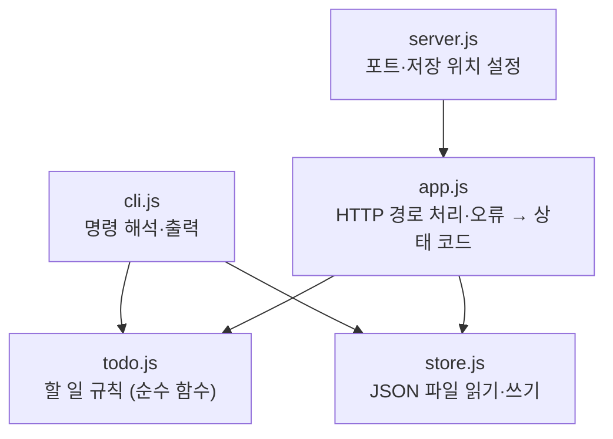

# 예제 실행 및 프롬프트

GUIDE.md의 실습을 **명령어와 프롬프트만** 모아 놓은 실행용 요약과, 각 단계의 **기대 결과 예시**입니다.
설명과 체크리스트는 [GUIDE.md](GUIDE.md)를 참고하세요. 7단계까지 마친 전체 결과는 [`example-result/`](example-result/)에 있습니다.

> 기대 결과는 실제로 이 실습을 끝까지 진행해 얻은 것입니다. 에이전트가 쓰는 문장과 그림 배치는 실행할 때마다 조금씩 달라지므로, **구조와 빠진 항목이 없는지**를 기준으로 비교하세요.

---

## 1. 명령·프롬프트 모음

### 1단계: 예제 저장소와 규칙 준비

```bash
mkdir -p ~/work
cp -r todo-app ~/work/todo-app
cp CLAUDE.md ~/work/todo-app/
mkdir -p ~/work/todo-app/.claude ~/work/todo-app/.github
cp -r skills ~/work/todo-app/.claude/skills
cp -r templates/ISSUE_TEMPLATE ~/work/todo-app/.github/
cd ~/work/todo-app
git init
npm test
npm run docs:check
git add .
git commit -m "todo-app 초기 버전 + 문서화 규칙"
claude
```

### 2단계: 요구사항 목록

```text
requirements 스킬을 사용해서 src/와 test/를 읽고 docs/requirements.md를 만들어줘.
사용자가 관찰할 수 있는 동작만 EARS 문형으로 적고, 모든 행의 상태는 '제안'으로 둬.
테스트로 확인되지 않는 동작은 검증 칸을 비워 둬.
```

```text
검토했어. 테스트가 있는 요구사항은 '구현됨'으로, 테스트가 없는 요구사항은 '승인'으로 바꾸고
검증 칸에 "확인 필요 — 테스트 없음"이라고 적어줘.
그리고 '구현됨' 요구사항을 검증하는 테스트 이름 앞에 [REQ-xxx]를 붙여줘.
```

### 3단계: 설계 모델링

```text
architecture 스킬을 사용해서 docs/architecture/overview.md를 만들어줘.
시스템 컨텍스트, 컨테이너, 컴포넌트 그림과 POST /todos 처리 순서의 시퀀스 다이어그램을 Mermaid로 그려줘.
```

```text
adr 스킬을 사용해서 "할 일 목록을 JSON 파일 하나에 저장한다"는 결정을 ADR-0001로 써줘.
배경은 이래: 교육용 예제라서 한 사람이 한 컴퓨터에서 쓰고, 할 일은 많아야 수백 개야.
설치 없이 Node.js만으로 실행돼야 해. 대안으로 SQLite와 별도 DB 서버를 검토했어.
docs/adr/README.md 목록도 만들고, overview.md의 관련 결정에 링크해줘.
```

### 4단계: API 문서

```text
api-docs 스킬을 사용해서 src/app.js의 HTTP API를 docs/api/openapi.yaml로 문서화해줘.
성공 응답과 발생할 수 있는 모든 오류 응답, 오류 코드, 예시를 빠짐없이 적어줘.
다 쓰면 npm run docs:api:lint를 실행해서 결과를 알려줘.
```

```bash
npm run docs:api:build      # docs/api/index.html 생성 → 브라우저로 열기
```

### 5단계: 사용자 매뉴얼

```text
user-manual 스킬을 사용해서 docs/manual/에 사용자 매뉴얼을 써줘.
명령은 TODO_FILE=manual-demo.json으로 실제로 실행해서 나온 출력만 붙이고, 끝나면 그 파일은 지워줘.
README.md에서 매뉴얼로 가는 링크도 추가해줘.
```

### 6단계: 이슈 보고서

```bash
TODO_FILE=bug-demo.json node src/cli.js add 우유 사기
TODO_FILE=bug-demo.json node src/cli.js done abc      # 오류: NaN번 할 일을 찾을 수 없습니다.
rm bug-demo.json
```

```text
bug-report 스킬을 사용해서 이 버그의 이슈 보고서를 docs/issues/에 써줘. 아직 코드는 고치지 마.
증상: node src/cli.js done abc 를 실행하면 "NaN번 할 일을 찾을 수 없습니다"가 나와.
비슷한 입력(번호 없음, 소수)도 재현해 보고, 원인 추정에는 근거 파일과 줄 번호를 적어줘.
```

```text
docs/issues/0001 보고서대로 버그를 고쳐줘.
먼저 요구사항을 추가하고, 테스트를 쓰고, 코드를 고친 다음 doc-sync 스킬로 관련 문서를 모두 갱신해줘.
보고서 상태도 해결됨으로 바꾸고 CHANGELOG.md를 만들어 Fixed에 기록해줘.
```

### 7단계: 기능 추가와 문서 동기화

```text
할 일 삭제 기능을 추가하려고 해.
requirements 스킬로 "번호를 지정해 삭제"와 "없는 번호 삭제 시 오류" 요구사항을 '승인' 상태로 추가해줘.
그리고 adr 스킬로 삭제 방식을 ADR-0002로 써줘. 하드 삭제(목록에서 완전히 지움)로 정했고,
소프트 삭제와 "마지막 번호를 따로 저장"하는 방식도 검토했어.
하드 삭제를 하면 번호가 재사용될 수 있는데, 그건 감수하기로 했어.
```

```text
삭제 기능을 구현해줘. CLI는 remove 번호, API는 DELETE /todos/{id}(성공하면 204)야.
테스트도 추가해줘. 이번에는 실습을 위해 문서(docs/, CHANGELOG.md)는 건드리지 마.
```

```bash
npm run docs:check          # ✗ DELETE /todos/{id} — 서버에는 있는데 API 문서에 없습니다.
```

```text
doc-sync 스킬을 사용해서 이번 삭제 기능 변경에 맞게 문서를 모두 갱신해줘.
고칠 필요가 없다고 판단한 문서는 이유를 한 줄씩 알려줘.
```

```bash
npm test && npm run docs:check && npm run docs:api:lint
git add . && git commit -m "feat: 할 일 삭제 (REQ-012, REQ-013, ADR-0002)"
```

---

## 2. 기대 결과 예시

### 1단계 — 문서가 없을 때의 검사 결과

```
[1] 요구사항 추적 (docs/requirements.md ↔ test/)
  ! docs/requirements.md 파일이 아직 없습니다. (2단계에서 만듭니다)
[2] API 문서 (src/app.js routes ↔ docs/api/openapi.yaml)
  ! docs/api/openapi.yaml 파일이 아직 없습니다. (4단계에서 만듭니다)
[3] 설계 결정 기록 (docs/adr/)
  ! docs/adr/ 폴더에 ADR이 아직 없습니다. (3단계에서 만듭니다)
[4] 문서 링크
  · 마크다운 1개, 상대 링크 0개

오류 0개, 경고 3개
```

### 2단계 — 요구사항 목록

7단계까지 마친 뒤의 표입니다. 2단계 직후에는 REQ-010까지만 있습니다. 테스트가 없는 REQ-007~009는 `승인`으로 남아 있어 **테스트가 비어 있는 곳**이 드러납니다.

| ID | 요구사항 | 우선순위 | 상태 | 검증 |
|---|---|---|---|---|
| REQ-001 | 사용자가 제목을 입력해 할 일을 추가하면, 시스템은 그 할 일을 미완료 상태로 목록 끝에 추가해야 한다. | 필수 | 구현됨 | `test/todo.test.js`, `test/app.test.js` |
| REQ-002 | 시스템은 새 할 일에 기존 번호 중 가장 큰 값보다 1 큰 번호를 매겨야 한다. 목록이 비어 있으면 1번부터 시작한다. | 필수 | 구현됨 | `test/todo.test.js` |
| REQ-003 | 만약 제목이 비어 있거나 공백뿐이면, 시스템은 할 일을 추가하지 않고 오류를 알려야 한다. | 필수 | 구현됨 | `test/todo.test.js`, `test/app.test.js` |
| REQ-004 | 사용자가 번호를 지정해 완료 처리하면, 시스템은 그 할 일만 완료 상태로 바꿔야 한다. | 필수 | 구현됨 | `test/todo.test.js`, `test/app.test.js` |
| REQ-005 | 만약 없는 번호를 완료 처리하려 하면, 시스템은 아무것도 바꾸지 않고 오류를 알려야 한다. | 필수 | 구현됨 | `test/todo.test.js`, `test/app.test.js` |
| REQ-006 | 사용자가 목록을 요청하면, 시스템은 각 할 일을 완료 여부 체크박스·번호·제목 형식으로 보여 주어야 한다. | 필수 | 구현됨 | `test/todo.test.js` |
| REQ-007 | 만약 목록이 비어 있으면, 시스템은 "할 일이 없습니다."라고 보여 주어야 한다. | 권장 | 승인 | 확인 필요 — 테스트 없음 |
| REQ-008 | 시스템은 할 일 목록을 파일에 저장해 프로그램을 다시 실행해도 유지해야 한다. | 필수 | 승인 | 확인 필요 — 테스트 없음 |
| REQ-009 | 저장 위치를 지정하는 기능이 있는 경우, 시스템은 `TODO_FILE` 환경 변수에 적힌 파일을 사용해야 한다. | 선택 | 승인 | 확인 필요 — 테스트 없음 |
| REQ-010 | 시스템은 할 일 조회·추가·완료를 JSON 기반 HTTP API로도 제공해야 한다. | 필수 | 구현됨 | `test/app.test.js` |
| REQ-011 | 만약 완료하거나 삭제할 번호가 1 이상의 정수가 아니면, 시스템은 아무것도 바꾸지 않고 번호 형식 오류를 알려야 한다. | 필수 | 구현됨 | `test/todo.test.js`, `test/app.test.js` |
| REQ-012 | 사용자가 번호를 지정해 삭제하면, 시스템은 그 할 일을 목록에서 지워야 한다. | 필수 | 구현됨 | `test/todo.test.js`, `test/app.test.js` |
| REQ-013 | 만약 없는 번호를 삭제하려 하면, 시스템은 아무것도 바꾸지 않고 오류를 알려야 한다. | 필수 | 구현됨 | `test/todo.test.js`, `test/app.test.js` |

테스트 이름에는 ID가 붙습니다.

```
[REQ-001][REQ-002] addTodo는 1부터 번호를 매긴다
[REQ-003] addTodo는 빈 제목을 거부한다
[REQ-004] completeTodo는 해당 항목만 완료로 바꾼다
[REQ-005] completeTodo는 없는 번호를 거부한다
[REQ-011] completeTodo는 정수가 아닌 번호를 거부한다
[REQ-006] formatTodos는 완료 여부를 체크박스로 보여준다
[REQ-001][REQ-010] POST /todos는 할 일을 만들고 201을 돌려준다
[REQ-010] GET /todos는 전체 목록을 돌려준다
[REQ-004][REQ-010] POST /todos/{id}/done은 완료 처리한 항목을 돌려준다
```

### 3단계 — 컴포넌트 그림과 ADR



규칙은 모두 `todo.js`에 있고, 파일 입출력은 `store.js`에만 있습니다. `cli.js`와 `app.js`는 둘을 이어 붙이는 얇은 층입니다(근거: 각 파일의 `import` 문).

ADR은 "고려한 대안"과 "결과(감수하는 점)"가 핵심입니다. 7단계에서 쓴 ADR-0002 전문:

~~~~markdown
# ADR-0002: 할 일 삭제는 목록에서 완전히 지우는 방식(하드 삭제)으로 한다

## 상태
승인

날짜: 2026-11-11

## 배경
할 일 삭제 기능을 추가한다(REQ-012, REQ-013). 지운 항목을 복구할 수 있게 남겨 둘지(소프트 삭제), 목록에서 완전히 지울지 정해야 한다. 이 결정은 저장 파일 형식([ADR-0001](0001-json-file-storage.md))과 번호 매기기 규칙(REQ-002)에 영향을 준다.

## 고려한 대안
| 대안 | 장점 | 단점 |
|---|---|---|
| 하드 삭제: 목록에서 항목을 지운다 | 저장 형식이 그대로, 구현이 단순 | 복구 불가. 마지막 번호를 지운 뒤 추가하면 그 번호가 다시 쓰인다 |
| 소프트 삭제: `deleted: true` 표시만 한다 | 복구 가능, 번호가 재사용되지 않음 | 모든 조회·완료 로직이 삭제 표시를 걸러야 함, 저장 형식 변경 |
| 하드 삭제 + 마지막 번호를 파일에 따로 저장 | 번호 재사용 없음 | 저장 형식을 배열에서 객체로 바꿔야 해 기존 파일과 호환되지 않음 |

## 결정
하드 삭제로 한다. 번호 매기기 규칙(가장 큰 번호 + 1)은 바꾸지 않는다.

## 결과
- 좋은 점: 저장 파일 형식과 기존 기능이 바뀌지 않는다.
- 감수하는 점: 지운 할 일은 복구할 수 없다. 가장 큰 번호의 할 일을 지운 뒤 새로 추가하면 같은 번호가 다시 쓰인다. 번호는 "지금 목록 안에서" 할 일을 가리키는 용도로만 쓴다.
- 다시 검토할 조건: 삭제 취소 기능이 필요하거나, 외부 시스템이 번호를 오래 저장해 두고 참조하게 되면 새 ADR로 소프트 삭제를 검토한다.
~~~~

### 4단계 — API 명세 (삭제 경로 부분)

오류 응답마다 `Error` 스키마와 예시를 붙입니다.

```yaml
  /todos/{id}:
    delete:
      operationId: deleteTodo
      summary: 할 일 삭제
      description: 지정한 번호의 할 일을 목록에서 완전히 지웁니다. 복구할 수 없으며, 지운 번호는 다시 쓰일 수 있습니다(ADR-0002). (REQ-012, REQ-013)
      tags: [todos]
      parameters:
        - $ref: "#/components/parameters/TodoId"
      responses:
        "204":
          description: 삭제됨. 응답 본문이 없습니다.
        "400":
          description: 번호가 1 이상의 정수가 아님 (REQ-011)
          content:
            application/json:
              schema:
                $ref: "#/components/schemas/Error"
              example:
                error:
                  code: INVALID_ID
                  message: 번호는 1 이상의 정수여야 합니다.
        "404":
          description: 해당 번호의 할 일이 없음
          content:
            application/json:
              schema:
                $ref: "#/components/schemas/Error"
              example:
                error:
                  code: NOT_FOUND
                  message: 99번 할 일을 찾을 수 없습니다.
```

검사 결과:

```
validating docs/api/openapi.yaml...
docs/api/openapi.yaml: validated in 31ms

Woohoo! Your API description is valid. 🎉
```

### 5단계 — 매뉴얼 구성

```
docs/manual/
├── index.md         ← 목차: 어떤 상황에 어떤 문서를 읽을지
├── tutorial.md      ← 빈 목록 → 추가 2개 → 완료 → 목록 확인 (한 가지 흐름)
├── how-to.md        ← 저장 위치 바꾸기, HTTP API로 쓰기, 삭제하기, 스크립트에서 오류 확인
├── reference.md     ← CLI 명령 표, 환경 변수 표, API 요약, 오류 메시지 표
└── explanation.md   ← 번호 매기기와 재사용, 저장 방식, CLI·서버 동시 사용 주의
```

레퍼런스의 오류 메시지 표는 소스의 메시지를 빠짐없이 담습니다.

| 메시지 | 언제 | CLI 종료 코드 | API 상태 / `error.code` |
|---|---|---|---|
| 제목은 비어 있을 수 없습니다. | 제목이 비어 있거나 공백뿐 | 1 | 400 / `EMPTY_TITLE` |
| 번호는 1 이상의 정수여야 합니다. | 완료·삭제할 번호가 숫자가 아니거나 0 이하, 소수 | 1 | 400 / `INVALID_ID` |
| N번 할 일을 찾을 수 없습니다. | 없는 번호를 완료 처리하거나 삭제 | 1 | 404 / `NOT_FOUND` |
| 요청 본문이 올바른 JSON이 아닙니다. | API 요청 본문이 JSON이 아님 | — | 400 / `INVALID_JSON` |
| 경로를 찾을 수 없습니다. | 없는 API 경로 | — | 404 / `ROUTE_NOT_FOUND` |

### 6단계 — 이슈 보고서

~~~~markdown
# [버그] `done`에 숫자가 아닌 번호를 넣으면 "NaN번 할 일을 찾을 수 없습니다"가 출력된다

- 상태: 해결됨 (REQ-011 추가, `completeTodo`에서 번호 형식 검사)
- 심각도: 낮음 (메시지, 표시 문제)
- 영역: CLI
- 관련 요구사항: REQ-011 (보고 당시에는 없었음. REQ-005는 "없는 번호"만 다룸)

## 재현 절차
1. `TODO_FILE=bug-demo.json node src/cli.js add 우유 사기`
2. `TODO_FILE=bug-demo.json node src/cli.js done abc`

## 기대 결과
번호 형식이 잘못되었다는 것을 알려 주는 메시지가 출력되고, 종료 코드는 1이다.

## 실제 결과
```text
오류: NaN번 할 일을 찾을 수 없습니다.
```
종료 코드는 1이고 목록은 바뀌지 않는다. 같은 증상이 아래에서도 나타난다.

```text
$ node src/cli.js done
오류: NaN번 할 일을 찾을 수 없습니다.
$ node src/cli.js done 1.5
오류: 1.5번 할 일을 찾을 수 없습니다.
```

## 환경
- Linux / Node.js 22.23.4 / 커밋 41438c3

## 원인 추정
`src/cli.js` L14에서 인자를 검사 없이 `Number(args[0])`로 바꾸므로 `"abc"`와 빈 값은 `NaN`이 된다. `src/todo.js` L21의 `completeTodo`는 번호 형식을 따로 검사하지 않고 "찾을 수 없음"으로 처리한다.

## 제안
- 요구사항 추가: "만약 번호가 1 이상의 정수가 아니면, 시스템은 아무것도 바꾸지 않고 번호 형식 오류를 알려야 한다."
- `completeTodo`에서 번호 형식을 먼저 검사하면 CLI와 HTTP API에 같은 규칙이 적용된다.
~~~~

### 6~7단계 — CHANGELOG

~~~~markdown
# 변경 기록

이 프로젝트의 주요 변경 사항을 기록합니다. 형식은 [Keep a Changelog](https://keepachangelog.com/ko/1.1.0/)를 따릅니다.

## [Unreleased]

### Added
- 할 일 삭제 기능: CLI `remove 번호`, API `DELETE /todos/{id}` — REQ-012, REQ-013, [ADR-0002](docs/adr/0002-hard-delete.md)

### Fixed
- `done`에 숫자가 아닌 번호를 넣으면 "NaN번 할 일을 찾을 수 없습니다"가 나오던 문제. 이제 "번호는 1 이상의 정수여야 합니다."를 출력하고, API는 400 `INVALID_ID`를 돌려준다 — REQ-011, [이슈 0001](docs/issues/0001-cli-done-non-numeric-id.md)
~~~~

### 7단계 — 코드만 고쳤을 때 / 문서까지 고쳤을 때

코드만 고친 직후:

```
[1] 요구사항 추적 (docs/requirements.md ↔ test/)
  · 요구사항 13개 (구현됨 8개), 테스트에서 참조 8개
[2] API 문서 (src/app.js routes ↔ docs/api/openapi.yaml)
  ✗ DELETE /todos/{id} — 서버에는 있는데 API 문서에 없습니다.
  · 서버 경로 4개, 문서 경로 3개
[3] 설계 결정 기록 (docs/adr/)
  · ADR 2개
[4] 문서 링크
  · 마크다운 13개, 상대 링크 22개

오류 1개, 경고 0개
```

doc-sync 뒤:

```
[1] 요구사항 추적 (docs/requirements.md ↔ test/)
  · 요구사항 13개 (구현됨 10개), 테스트에서 참조 10개
[2] API 문서 (src/app.js routes ↔ docs/api/openapi.yaml)
  · 서버 경로 4개, 문서 경로 4개
[3] 설계 결정 기록 (docs/adr/)
  · ADR 2개
[4] 문서 링크
  · 마크다운 13개, 상대 링크 25개

오류 0개, 경고 0개
```

---

## 3. 완성 예시와 비교하기

내 결과와 `example-result/`를 파일 단위로 비교합니다. 이 모듈 폴더에서 실행합니다.

```bash
diff -rq --exclude=.git --exclude=node_modules --exclude=index.html example-result ~/work/todo-app
```

`Only in example-result: …`로 나오는 파일은 내 저장소에 빠진 문서입니다. 내용이 다른 파일(`… differ`)은 정상입니다. 에이전트가 쓴 문장은 매번 다르기 때문입니다. 대신 아래 항목을 확인하세요.

- [ ] 요구사항이 13개 안팎이고, 삭제·번호 형식 오류 요구사항이 `구현됨`이다.
- [ ] ADR이 2개 있고, 둘 다 대안 표와 "감수하는 점"이 있다.
- [ ] API 명세에 경로 4개(목록, 추가, 완료, 삭제)와 `INVALID_ID` 오류가 있다.
- [ ] 매뉴얼 레퍼런스에 `remove` 명령과 `번호는 1 이상의 정수여야 합니다.` 메시지가 있다.
- [ ] 이슈 보고서 상태가 `해결됨`이고, CHANGELOG에 `Added`와 `Fixed`가 있다.

완성 예시 자체도 검사를 통과합니다.

```bash
cd example-result
npm test
npm run docs:check
```
