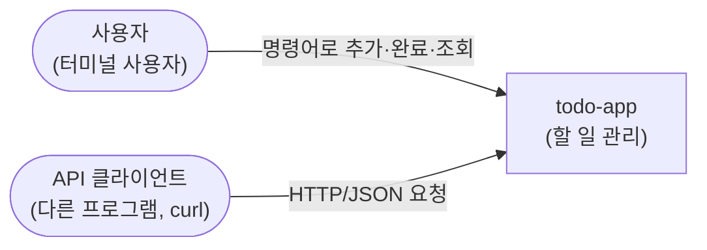
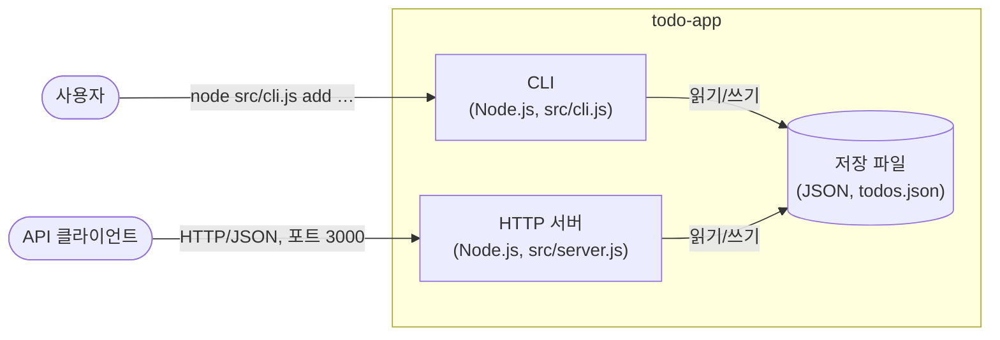
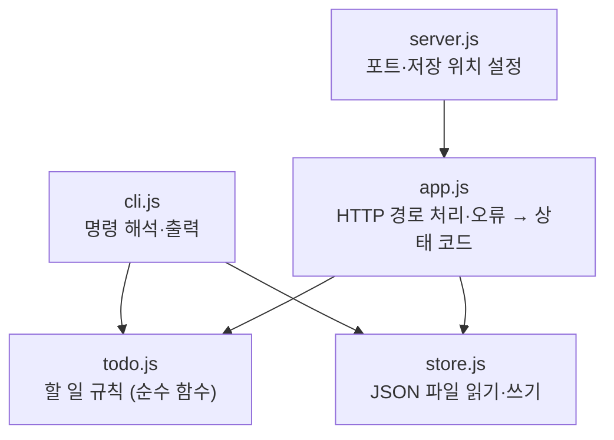
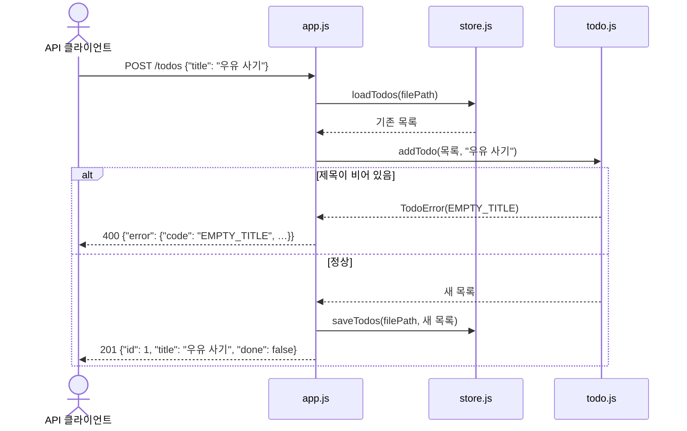

# 아키텍처 개요

> 이 문서는 코드(`src/`)에서 생성했으며 2026-11-11 기준입니다. 설계 이유는 [설계 결정 기록](../adr/README.md)을 참고하세요.

## 1. 시스템 컨텍스트

todo-app은 외부 시스템에 의존하지 않습니다. 사람은 CLI로, 다른 프로그램은 HTTP API로 사용합니다.

## 2. 컨테이너

CLI와 HTTP 서버는 별개의 실행 단위이지만 같은 저장 파일을 씁니다. 저장 파일 위치는 `TODO_FILE` 환경 변수로 바꿀 수 있습니다(근거: `src/cli.js`, `src/server.js`). 저장 방식은 [ADR-0001](../adr/0001-json-file-storage.md)에서 정했습니다.

## 3. 컴포넌트

규칙은 모두 `todo.js`에 있고, 파일 입출력은 `store.js`에만 있습니다. `cli.js`와 `app.js`는 둘을 이어 붙이는 얇은 층입니다(근거: 각 파일의 `import` 문).

## 4. 동적 뷰 — 할 일 추가 (`POST /todos`)

## 5. 관련 결정

- [ADR-0001: 할 일 목록을 JSON 파일 하나에 저장한다](../adr/0001-json-file-storage.md)
